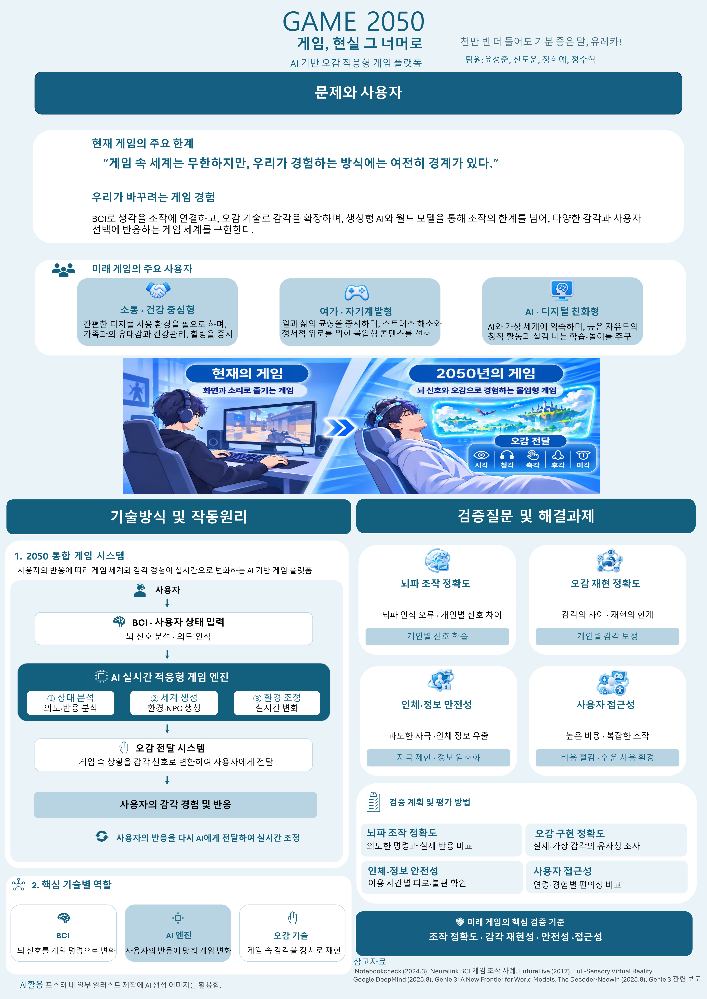

# Welcome to E26-SW02-05

## 🎯 팀 슬로건

천만번 더 들어도 기분 좋은 말 유레카 

## 🖼️ 팀 포스터

<div class="poster"></div>

**GAME 2050 — 게임, 현실 그 너머로**

**AI 기반 오감 적응형 게임 플랫폼**

본 포스터는 2050년 미래 게임의 변화 방향을 상상하고, BCI(뇌-컴퓨터 인터페이스), 생성형 AI 및 월드 모델, 오감 전달 기술을 결합한 미래형 게임 플랫폼을 제안합니다.

사용자의 의도와 반응에 따라 게임 세계가 실시간으로 변화하고, 다양한 감각으로 게임을 경험하는 미래를 표현하였습니다.

- [📄 포스터 최종 — A0 인쇄·발표용 PDF](GAME2050_A0포스터%20.pdf)
- [🖼️ 팀 포스터 이미지](poster.jpg)


**AI 활용:** 포스터 내 일부 일러스트 제작에 생성형 AI를 활용하였습니다.


***

## 1️⃣ 팀원 소개

| **이름** | **전공** | **관심사** |
| --- | --- | --- |
| **윤성준** | 소프트웨어학부 | 코딩, 게임, 소설|
| **정수혁** | 소프트웨어학부 | 코딩, 게임, 학업, 인공지능 |
| **장희에** | 소프트웨어학부| 알고리즘, 시스템 프로그래밍, |
| **신도운** | 소프트웨어학부 | ai, 게임, 코딩 |

유레카프로젝트 팀 생성을 축하합니다.
팀의 제목과 슬로건, 팀원의 이름 및 관심사를 변경하세요.

### 팀 소개

팀의 소개를 작성합니다.

***

## 2️⃣ 공통된 관심사 : 여행, 백엔드, 인공지능

***

## 3️⃣ 한학기 동안의 활동 내역 

-9/18일 활동 내역

Why-What-How 심층 분석

WHY — 과거의 문제의식

장거리 운전에서 생기는 피로와 졸음, 운전자의 판단 실수로 인한 교통사고를 줄이는 것이 중요한 문제였다.
특히 고령자나 장애인처럼 직접 운전하기 어려운 사람들에게는 이동의 제약도 있었다.
단순히 목적지까지 이동하는 것에서 벗어나, 운전하는 동안에도 편하게 쉬거나 다른 일을 할 수 있는 이동 방식을 생각했다.

WHAT — 상상한 해결 방식

운전자가 직접 조작하지 않아도 자동차가 주변 도로와 교통상황을 스스로 파악해 목적지까지 이동하는 모습을 상상했다.
자동차 내부도 운전하기 위한 공간보다는 하나의 생활공간처럼 구성해, 승객들이 서로 대화를 나누거나 편하게 쉴 수 있도록 했다.
센서와 차량 간 통신을 이용해 교통상황을 파악하고 안전하고 효율적으로 목적지까지 이동하는 것이 핵심이었다.

HOW — 현재의 구현 방식

현재는 카메라, LiDAR, 레이더 등의 센서와 AI 소프트웨어를 이용해 주변 환경을 파악하고 차량을 제어하는 자율주행 기술이 실제 차량에 적용되고 있다.
테슬라, Waymo, 현대자동차 등에서도 자율주행 기술이 상용화되고 있으며, 일반적인 도로 환경에서는 상당 부분 자율주행이 가능한 수준까지 발전했다.
다만 예상하기 어려운 돌발 상황이나 기술적·법적 한계가 남아 있어, 1965년에 상상했던 완전한 무인 운전과는 아직 차이가 있다.

NEXT — 남은 문제와 한계

가려진 물체나 갑작스러운 상황, 극단적인 날씨 등 다양한 도로 환경에서도 안정적으로 대응하는 것이 아직 어려운 부분이다.
자율주행 시스템의 오류나 해킹으로 사고가 발생했을 때 누가 책임을 져야 하는지에 대한 법적 문제도 남아 있다.
사고를 피하기 어려운 상황에서 AI가 어떤 기준으로 판단해야 하는지에 대한 윤리적인 문제도 생각해 볼 필요가 있다.
또한 자율주행이 확대되면 택시·버스·화물차 운전자 등 운송업 종사자의 일자리 변화와 같은 사회적 문제도 함께 나타날 수 있다.

10/2일 활동 내역

1. 팀원별 문제 및 아이디어

팀원 1 - 학생식당 혼잡도 문제

현재 학생식당은 사람이 얼마나 많은지, 얼마나 기다려야 하는지를 직접 방문하기 전에는 알기 어렵다. 이로 인해 식당에 도착한 뒤 혼잡한 상황을 확인하거나 긴 대기시간으로 시간을 낭비하는 문제가 발생한다.

AI를 통한 문제 재정의

수용 인원이 제한된 공간에서 이용자가 이동하기 전에 현재 혼잡 상태와 예상 대기시간을 알 수 없어 합리적인 선택을 하기 어려운 문제

제안 아이디어

학생식당의 현재 이용 인원과 혼잡도를 실시간으로 제공
예상 대기시간을 함께 표시
앱이나 웹을 통해 식당에 가기 전에 확인할 수 있도록 구성
시간대별 혼잡도를 제공하여 이용자가 방문 시간을 선택할 수 있도록 함

팀원 2 - 원격 출석 문제

직접 출석 단말기를 이용하면 정상적으로 인식되지만, 블루투스나 원격 출석 기능을 사용할 경우 인식이 제대로 되지 않는 경우가 있다. 이로 인해 학생이 다시 단말기로 이동해야 하고, 출석 시간에 단말기 주변으로 학생들이 몰리는 문제도 발생한다.

AI를 통한 문제 재정의

사용자가 정해진 공간에 실제로 있다는 것을 확인하면서, 별도의 이동 없이 안정적으로 출석을 인증하기 어려운 문제

제안 아이디어

교실 안에 있는 학생이 원격으로 출석할 수 있도록 개선
블루투스나 Wi-Fi 등을 활용하여 사용자의 위치를 확인
원격 출석의 인식률과 안정성을 높임
출석 실패로 단말기까지 다시 이동해야 하는 상황을 줄임

팀원 3 - 실시간 공간 정보 문제

학생들이 학교의 특정 공간을 이용할 때 직접 방문하기 전에는 해당 공간의 이용 인원이나 혼잡 정도를 알기 어렵다는 문제를 제시하였다. 필요한 정보를 미리 확인할 수 있다면 불필요한 이동과 대기시간을 줄일 수 있다.

AI를 통한 문제 재정의

사용자가 직접 현장에 방문하지 않아도 공간의 현재 상태를 확인하고 이용 여부를 판단할 수 있는 정보가 부족한 문제

제안 아이디어

센서나 출입 데이터를 활용하여 공간의 이용 인원을 파악
현재 혼잡도를 실시간으로 제공
이용 가능 여부와 예상 대기시간 등을 함께 제공
모바일 웹이나 앱에서 공간 정보를 확인할 수 있도록 함

 2. 팀 종합 의견

팀원들의 의견을 종합한 결과, 각자의 주제는 다르지만 사용자가 직접 현장에 방문하거나 이동하지 않아도 현재 상황을 확인하고 서비스를 이용할 수 있도록 해야 한다는 공통점을 확인하였다.

팀원 1은 학생식당의 실시간 혼잡도와 대기시간, 팀원 2는 안정적인 원격 출석, 팀원 3은 공간의 실시간 이용 정보에 중점을 두었다.

이를 바탕으로 우리 팀은 실시간으로 공간의 상태를 확인할 수 있는 시스템을 중심 아이디어로 발전시키기로 하였다. 이를 통해 학생들이 직접 확인하기 위해 이동하거나 불필요하게 기다리는 상황을 줄이고, 현재 상황을 미리 파악하여 보다 편리하게 학교 공간을 이용할 수 있도록 하는 것을 목표로 한다.

- 기관/부서 인터뷰 ✔️  

- 현장 탐방 ✔️  

- 멘토링 ✔️  
  - 내 지도 교수 함게 만나기
  - 대학원 방문 및 선배 만나기

- 프로젝트 진행 ✔️  
  - 과거에 사람들이 상상한 미래
  - 그들이 만들어가는 세상
  - 우리가 상상한 미래
  - 우리가 그리는 미래 그리고 나

- 각오와 소감 나누기 ✔️  


<!-- 활동 사진 추가 예시 -->


***

## 4️⃣ 인상 깊은 활동

- 활동명 – 활동에 대한 간단한 설명과 배운 점을 작성  
- 예: 멘토링에서 실리콘밸리 현업 경험을 들을 수 있어 진로 방향 설정에 큰 도움이 되었다.  

***

## 5️⃣ 특별히 알아보고 싶은 것
- 예: 현장실습 제도
- 예: 학부 졸업 인증 조건
- 예: 성취기반평가
- 예: 졸업 후 진로(대학원/취업)

***

## 6️⃣ 활동을 마친 소감

🔗학번 이름  
> "소감 내용을 여기에 작성합니다."

🔗학번 이름  
> "소감 내용을 여기에 작성합니다."

🔗학번 이름  
> "소감 내용을 여기에 작성합니다."

🔗학번 이름  
> "소감 내용을 여기에 작성합니다."

🔗학번 이름  
> "소감 내용을 여기에 작성합니다."


## Markdown을 사용하여 내용꾸미기를 익히세요.

Markdown은 작문을 스타일링하기위한 가볍고 사용하기 쉬운 구문입니다. 여기에는 다음을위한 규칙이 포함됩니다.

```markdown
Syntax highlighted code block

# Header 1
## Header 2
### Header 3

- Bulleted
- List

1. Numbered
2. List

**Bold** and _Italic_ and `Code` text

[Link](url) and 
```

자세한 내용은 [GitHub Flavored Markdown](https://guides.github.com/features/mastering-markdown/).

### Support or Contact

readme 파일 생성에 추가적인 도움이 필요하면 [도움말](https://help.github.com/articles/about-readmes/) 이나 [contact support](https://github.com/contact) 을 이용하세요.

